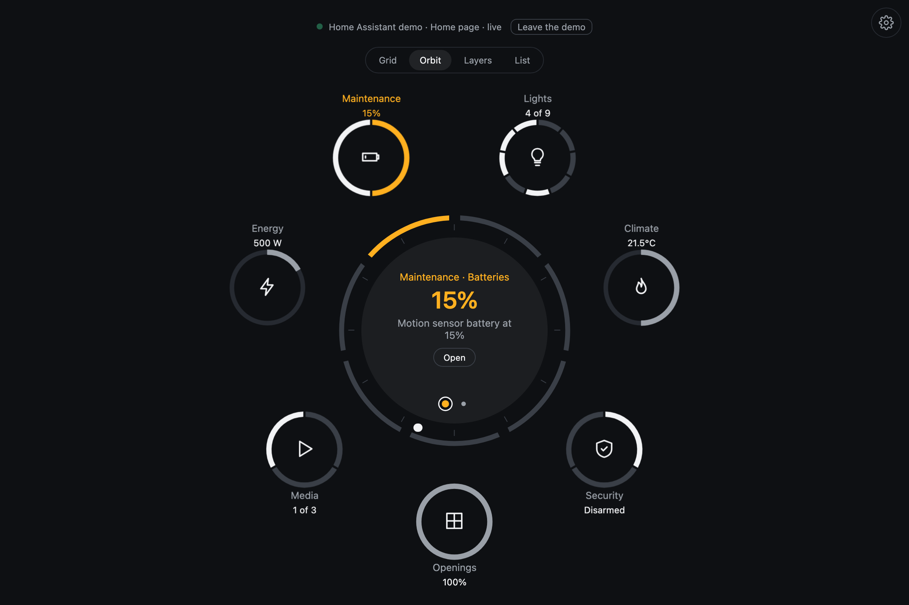
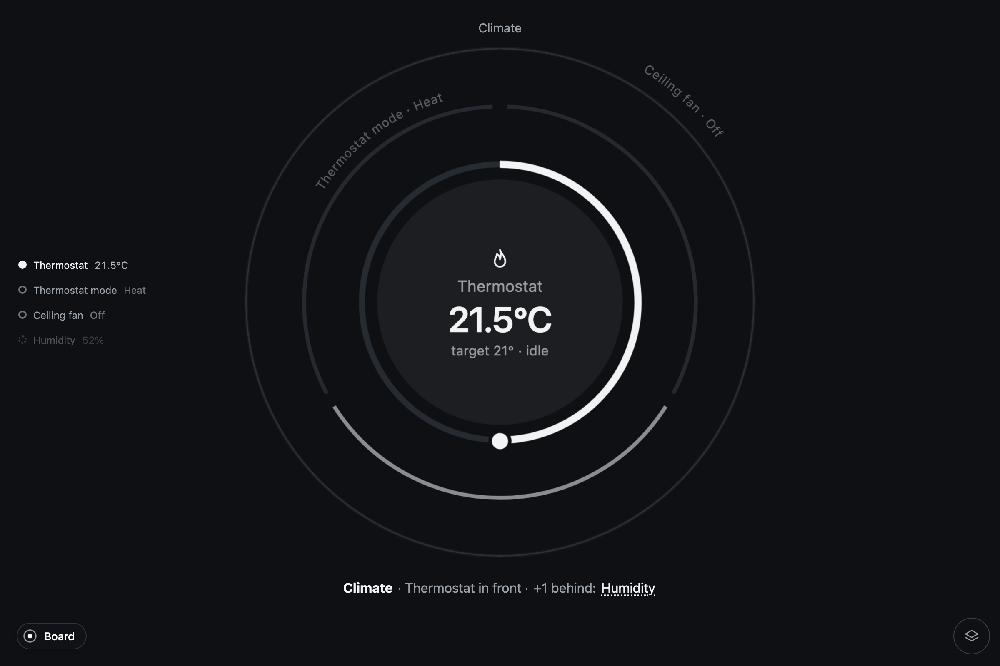
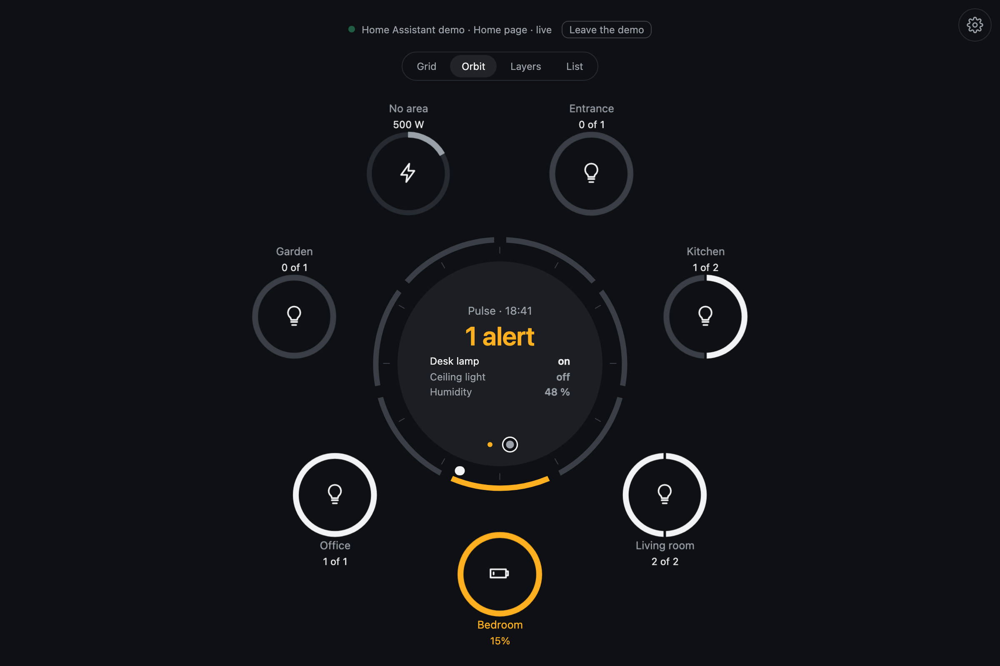
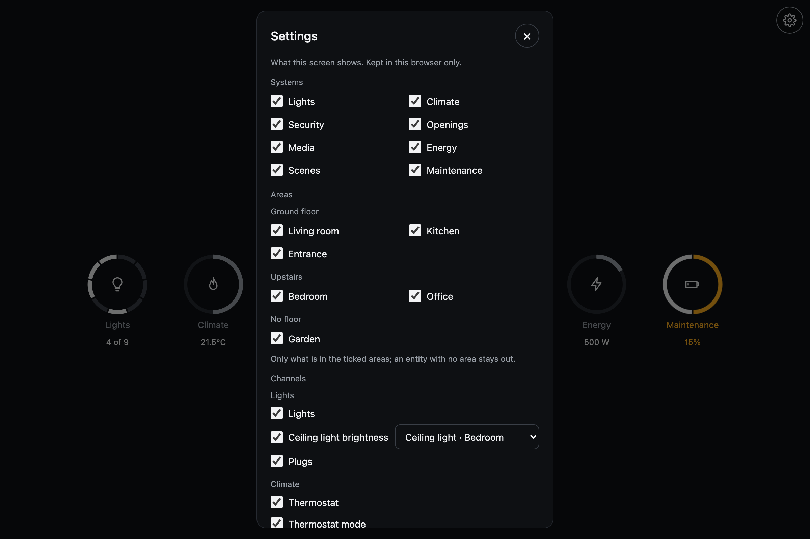

# Pulse

A radial interface for monitoring and controlling systems.

Pulse shows each system as a circular object with layers for its readings and
controls. In a home, for example, the climate system can have a thermostat in
front, with its mode and fan controls behind it. You drag the ring to change the
temperature or tap another layer to bring it forward.

When an alert appears, Pulse brings that layer to the front. Once the alert is
resolved, the layer moves behind the active one. You can see what needs
attention while keeping the other readings and controls within reach.

Home Assistant is the most complete integration so far. There is also a homelab
app that reads a Mac or Linux machine through a small collector, and a demo app
with simulated data. Each app connects its data and actions to the same interface.

Site: [zumerlab.com/pulse](https://zumerlab.com/pulse/) (the pages are in
[`docs/`](docs/)). Rings and layers are [Orbit](https://zumerlab.com/orbit/);
the zoom between levels is [Zumly](https://zumerlab.com/zumly/).



## How it works

- **Layers show priority.** The active channel sits in front. An alert brings
  its layer forward; a more serious alert takes priority. When resolved, the
  layer moves back behind the active one.
- **A few layers stay visible.** The default is three on a desktop and two on
  a phone. Other channels remain accessible by name. Only the front layer has
  a full disc; the layers behind it show a ring and a label.
- **Alerts mark the affected part.** A heavier stroke, color and a wave draw
  attention to a ring, segment or label. The disc stays unchanged.
- **Controls sit on the ring.** Drag a band to adjust a value, tap a segment to
  toggle a device, or choose a mode by name. Actions that need a code open a
  keypad. A separate detail view opens when there is more to show, such as
  history or a camera feed.
- **Commands wait for confirmation.** The control pulses while a command is
  pending and settles when the source reports back. A rejected command leaves
  a red outline and a Retry option.

Read about the [design decisions](docs/principles.html),
[object structure](docs/object.html), [components](docs/elements.html)
and [board views](docs/board.html).

## Home Assistant

Pulse reads the states Home Assistant already pushes to the dashboard. There is
no entity list to write: each channel picks its entities by domain, device class
or capability. Channels with nothing to show stay out, so the available entities
determine which controls appear.

| | |
|---|---|
|  |  |
| Drag the front ring to adjust the thermostat. | A battery alert moves to the front, with an action below. |
|  |  |
| The same home by room, each area an object. | Settings for this screen, saved in this browser. |

Use Pulse in Home Assistant as a custom card, a dashboard or section strategy,
or a standalone app for a kiosk or wall tablet.

The eight systems cover lights, climate, security, openings, media, energy,
scenes and maintenance. Alerts can combine readings across systems, such as
heating with a window open or motion while the alarm is armed. Numbers and
times follow your Home Assistant profile's language; entity states use Home
Assistant's translated labels where available.

Install, options and troubleshooting:
[`apps/home-assistant/card/README.md`](apps/home-assistant/card/README.md).
The repository includes six interactive homes from demo.home-assistant.io,
so you can try the interface without a Home Assistant instance.

## Layout

| Directory | Contents |
|---|---|
| [packages/core](packages/core/README.md) | Shared board, radial components, controls, themes and host interface |
| [apps/demo](apps/demo/README.md) | Simulated systems and a component gallery |
| [apps/home-assistant](apps/home-assistant/README.md) | Standalone Home Assistant app, demo homes, card and dashboard strategies |
| [apps/homelab](apps/homelab/README.md) | Machine monitoring app and a Node.js collector for Mac and Linux |
| `tests/` | Playwright tests |
| `docs/` | Website, component reference and design documentation |

Each app converts its source data into the core's systems and readings and
runs the actions the interface requests. The apps depend on the core through
the npm workspace.

## Run

Requires Node.js 22.18+ or 24+ and npm.

```sh
npm ci
npm run dev        # demo, http://127.0.0.1:5173
npm run dev:ha     # Home Assistant, http://127.0.0.1:5174; sign in with your Home Assistant account
                   # index of the demo homes: http://127.0.0.1:5174/gallery.html
npm run collect    # the homelab collector, on the machine to watch: http://127.0.0.1:5180
npm run dev:homelab  # homelab, http://127.0.0.1:5175; ?demo for the demo machine
```

```sh
npm run typecheck   # TypeScript, whole workspace
npm run lint        # ESLint
npm test            # Playwright: the demo app, the Home Assistant app over its demo homes, the homelab app over its demo machine
npm run build:card  # the Home Assistant card + strategies as one module: apps/home-assistant/dist-card/zumer-pulse.js
                    # install and options: apps/home-assistant/card/README.md; bench without HA: http://127.0.0.1:5174/card.html
npm run build       # typecheck and build the apps
```

## Your own source

A host supplies systems and readings, reports changes, runs actions and provides
names for the data. The `PulseHost` interface is defined in
`packages/core/src/model.ts`.

A system has channels. Each channel returns a ring, a value and a label, with
optional alerts and detail content. The homelab app provides a small working
adapter; the Home Assistant app adds registries, rooms and richer history.

Start with [Your own source](docs/sources.html) for the data model and
[In your project](docs/adapt.html) for setup. The component gallery at
`apps/demo/elements.html` shows individual components with sample data under
each of the seven built-in themes.

## Language

Everything in the repository is in English: code, comments, commits and docs.
Shared interface strings live in `packages/core/src/i18n.ts`, each app adds its own
in `strings.ts`; numbers and times follow the language the source reports.
Translations can be added through those dictionaries.

## License

[MIT](LICENSE). Made by [ZumerLab](https://zumerlab.com).
