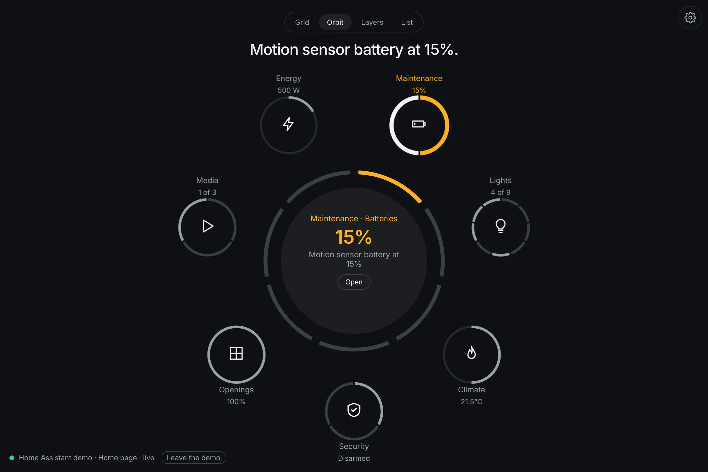
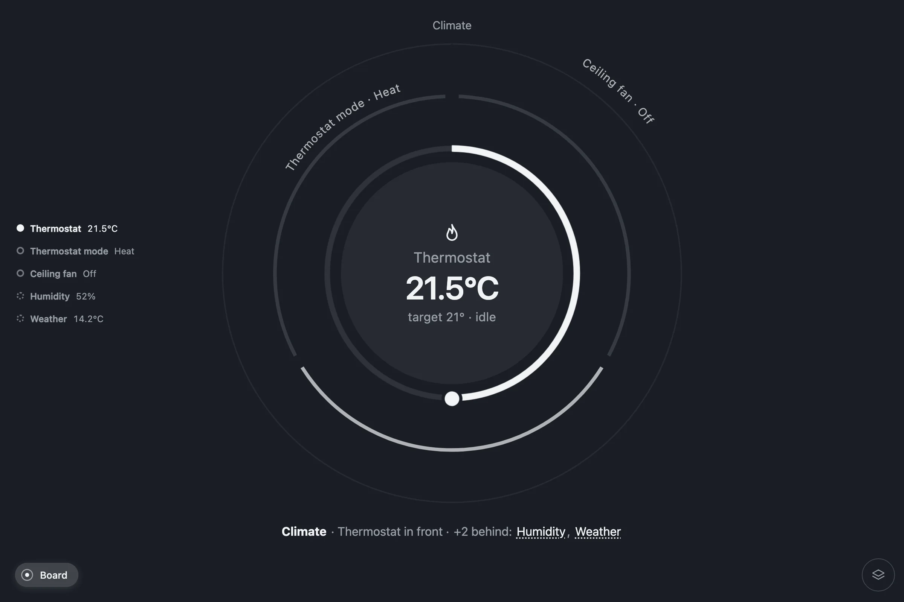
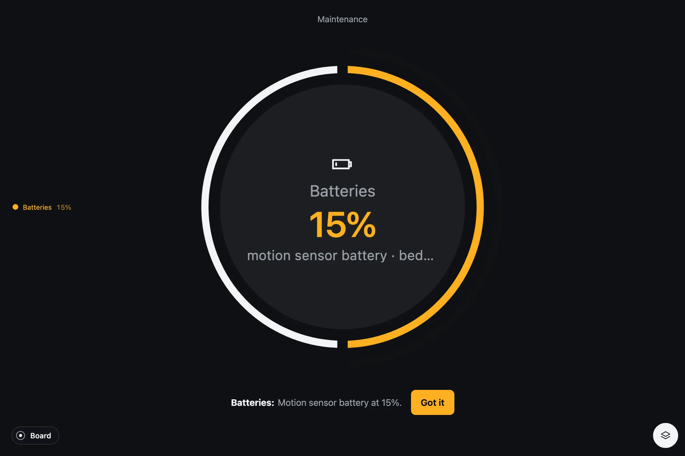
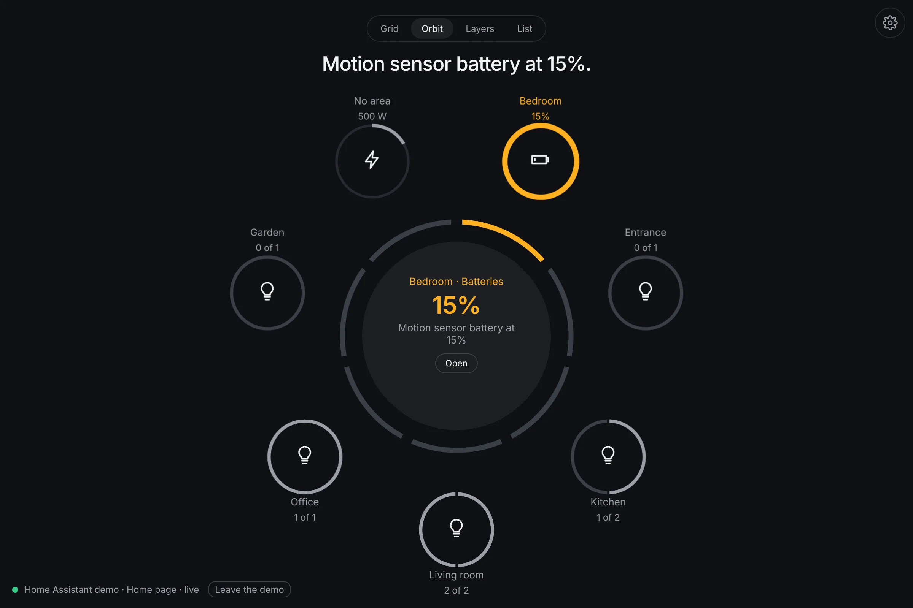
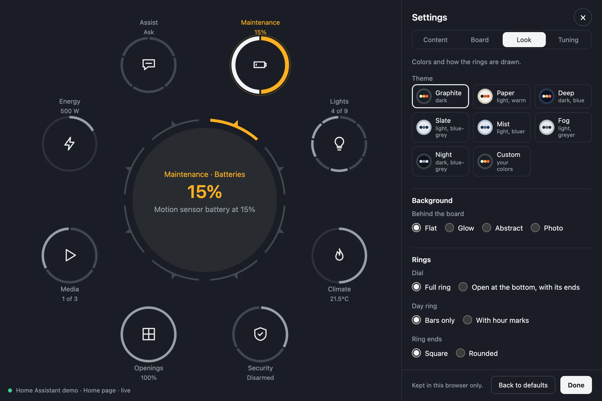

# Pulse

A radial interface for monitoring and controlling systems.

Pulse shows each system as a circular object with layers for its readings and
controls. In a home, for example, the climate system can have a thermostat in
front, with its mode and fan controls behind it. You drag the ring to change the
temperature or tap another layer to bring it forward.

When an alert appears, Pulse brings that layer to the front. Once the alert is
resolved, the layer moves behind the active one. You can see what needs
attention while keeping the other readings and controls within reach.

This repository is the core, `@zumer/pulse`: the object, the board and the
contract a source fills, with a demo of simulated data. The apps that connect
a real source are separate repositories (see [Sources](#sources)).

The site, with the full documentation, is
[zumerlab.com/pulse](https://zumerlab.com/pulse/). Rings and layers are
[Orbit](https://zumerlab.com/orbit/); the zoom between levels is
[Zumly](https://zumerlab.com/zumly/).



## How it works

- **Layers show priority.** The active channel sits in front. An alert brings
  its layer forward; a more serious alert takes priority. When resolved, the
  layer moves back behind the active one.
- **A few layers stay visible.** The default is three on a desktop and two on
  a phone. Other channels remain accessible by name. Only the front layer has
  a full disc; the layers behind it show a ring and a label.
- **Alerts mark the affected part.** A heavier stroke, color and a wave draw
  attention to a ring, segment or label. The disc stays unchanged.
- **Controls sit on the ring.** Drag a band to adjust a value, tap a segment to
  toggle a device, or choose a mode by name. Actions that need a code open a
  keypad. A separate detail view opens when there is more to show, such as
  history or a camera feed.
- **Commands wait for confirmation.** The control pulses while a command is
  pending and settles when the source reports back. A rejected command leaves
  a red outline and a Retry option.

| | |
|---|---|
|  |  |
| Drag the front ring to adjust the thermostat. | A battery alert moves to the front, with an action below. |
|  |  |
| The same home by room, each area an object. | Settings for this screen, saved in this browser. |

Read about the [design decisions](https://zumerlab.com/pulse/principles.html),
[object structure](https://zumerlab.com/pulse/object.html), [components](https://zumerlab.com/pulse/elements.html)
and [board views](https://zumerlab.com/pulse/board.html).

## Sources

The object is the same whatever feeds it. Each source is an app built on the
core, in its own repository. The first is the home:
[Pulse for the home](https://github.com/zumerlab/pulse-home) runs on Home
Assistant and on openHAB, as a card, a dashboard, a section, a page the server
itself serves, or a standalone app. [Your own source](#your-own-source) below
is how to write another.

## Install

```sh
npm install @zumer/pulse @zumer/orbit zumly
```

Four stylesheets and two runtimes, then the board:

```ts
import 'zumly/style.css';
import '@zumer/orbit/style';
import '@zumer/orbit';
import '@zumer/pulse/style.css';
import { mountBoard } from '@zumer/pulse';

const board = mountBoard(canvas, {
  host,
  settings: 'my-settings',
  strings: { things: 'Sensors' },
});

// When removing the interface:
board.destroy();
```

Here, `canvas` is the element inside your page's shell and `host` implements
`PulseHost`. For the page structure and a complete adapter, follow
[In your project](https://zumerlab.com/pulse/adapt.html).

## Your own source

A host supplies systems, reports changes and runs actions. It also provides
names and state labels for the data. Optional methods supply history, camera
streams, statistics and groups such as rooms. The `PulseHost` interface is
defined in [src/model.ts](src/model.ts).

Each system has channels. A channel returns a `Reading`, or `null` when it
has nothing to show. Readings describe one of three ring types:

| Kind | Display and interaction |
|---|---|
| `'p'` | Progress band; an optional dial or range makes it adjustable |
| `'s'` | Segments representing switches |
| `'c'` | Named options with one selected |

Readings also include the main value, a label and the entity ids they depend
on. They can add alerts and detail content such as history, an image, a color
control or a longer list. A reading with a `map` opens a detail where the map
is big, follows the reading live, zooms with the wheel, a pinch or its
buttons and moves with a drag or the arrows; a `link` adds a button out to the
thing elsewhere. A picture with a `video` plays muted over its still, in the
face and in the detail: a live HLS stream or a video file. A segment or a row
can name a thing with its own object (`to`): with `objectOf(id)` the host
makes it, and tapping the row zooms into it. A reading's `plots` are a radar,
its `globe` the disc as the Earth, its `map` a window on a tiled map.

Actions belong to the host. The board sends them through `act`, tracks the
ids they affect and waits for reported changes. An action that requires a
code opens a keypad first; one that asks for words opens an input instead.

Start with [In your project](https://zumerlab.com/pulse/adapt.html) for the setup.
The [Tutorial](https://zumerlab.com/pulse/tutorial.html)
builds one from zero, with screens: a simulated greenhouse as three objects,
whose code is in [demo/greenhouse/](demo/greenhouse/). The component gallery at
`demo/elements.html` shows individual components with sample data under each
of the seven built-in themes.

## Board options and lifecycle

`mountBoard(canvas, options)` returns a handle for updating and removing the
interface. Options include available systems and groups, initial view,
starting system, appearance, layer counts, status text and translated strings.

Browser preferences are saved under the key supplied as `settings`.
Set `settings: false` to disable the settings panel and saved preferences.

Use `setHost` to change data sources, `setSettings` to update display choices,
`repaint` to refresh the views and `destroy` to release the board's resources.
The `ready` promise tracks initialization. See
[src/board/types.ts](src/board/types.ts) for the full options and handle types.

## Layout

| Directory | Contents |
|---|---|
| [src/](src/) | The package: the contract, the board, the radial components, the themes, the strings, the stylesheet |
| [demo/](demo/README.md) | Simulated systems, a component gallery and the tutorial's greenhouse; `npm run dev` serves them |
| `tests/` | Playwright tests, run against the demo |
| [docs/](docs/) | Website, component reference and design documentation |
| `scripts/` | `land.mjs`, which generates the globe's coasts |

Inside `src/`:

| Module | Responsibility |
|---|---|
| [model.ts](src/model.ts) | Host, system, channel, reading and action contracts |
| [board/](src/board/) | Board state, settings, commands, views and lifecycle |
| [radial/](src/radial/) | Visual components, gestures, dimensions and Zumly setup |
| [themes.ts](src/themes.ts) | Seven themes and helpers for applying colors |
| [tune.ts](src/tune.ts) | Layout parameters exposed by the Tuning tab |
| [history.ts](src/history.ts) | Hourly aggregation and state-change helpers |
| [i18n.ts](src/i18n.ts) | Shared interface text and locale formatting |
| [style.css](src/style.css) | Entry stylesheet, importing the modules in `styles/` |

Inside `board/`, `mount.ts` handles setup and cleanup, `context.ts` defines the
shared state, and separate modules handle settings, actions, drawing, history,
dials and the settings panel. `views/` contains system, detail and change
views, with a module for each board layout.

Inside `radial/`, components are grouped by family: rings, objects, keypads,
color controls, time displays and lists. You can use these independently of
`mountBoard`; the [demo](demo/README.md) does this.

The base stylesheet uses Graphite. Other built-in themes are Paper, Deep,
Slate, Mist, Fog and Night. `applyTheme` selects one; `applyColors` supplies
custom colors.

## Run

Requires Node.js 22.18+ or 24+ and npm.

```sh
npm ci
npm run dev        # the demo, http://127.0.0.1:5173; the component gallery at /elements.html; the tutorial's greenhouse at /greenhouse/
npm test           # lint, types, the build, then Playwright over the demo
npm run compile    # the package into dist/: index.js, its types, the stylesheet
```

## Release

Commits follow [Conventional Commits](https://www.conventionalcommits.org/)
(`feat:`, `fix:`, `docs:`, `refactor:`, `chore:`): the version bump and the
changelog read them.

```sh
npm test
npm run bump       # suggests the next version from the commits, tags it, writes CHANGELOG.md
npm run release    # commits the changelog and pushes with the tag
npm publish        # compiles first
```

## Data

The globe's coasts (`src/radial/land.ts`) are Natural Earth's land at
1:110,000,000, public domain, taken from the
[world-atlas](https://github.com/topojson/world-atlas) package and decimated
by `scripts/land.mjs`. The map face loads tiles from
[OpenStreetMap](https://www.openstreetmap.org/copyright) by default
(© OpenStreetMap contributors), whose tile policy asks for light use; a host
passes its own `tiles` template for anything heavier.

## Language

Everything in the repository is in English: code, comments, commits and docs.
Shared interface strings live in `src/i18n.ts`, each app adds its own in
`strings.ts`; numbers and times follow the language the source reports.
Translations can be added through those dictionaries.

## License

[MIT](LICENSE). Made by [ZumerLab](https://zumerlab.com).
