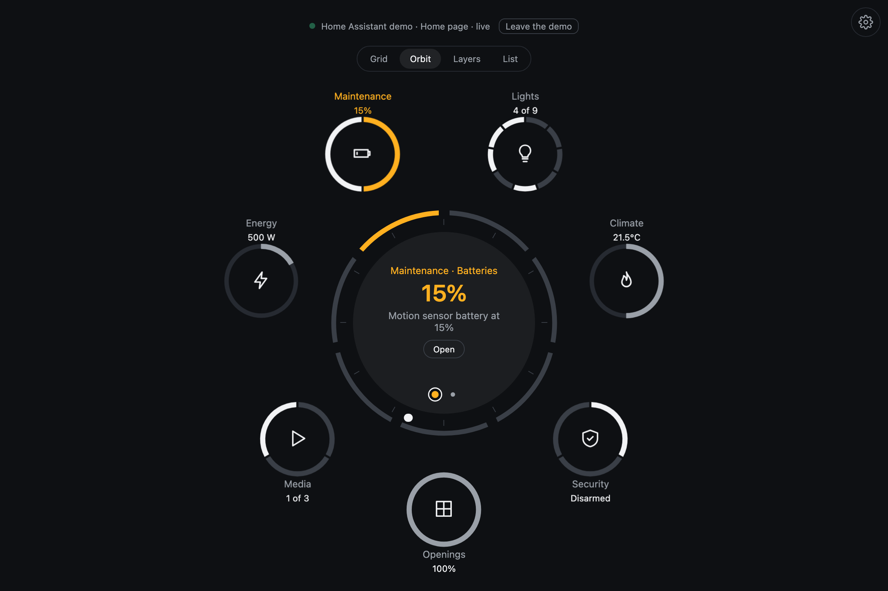

# Pulse for Home Assistant

Monitor and control your home through rings and layers. Pulse groups your
Home Assistant entities into systems such as lights, climate and security.
Open a system to adjust a value, switch a device or choose a mode. Alerts bring
the affected channel to the front, with an action when one is available.

You can run Pulse as a standalone web app or use it inside a Home Assistant
dashboard. Both use the same interface and entity model.



For card installation, dashboard strategies and YAML options, see the
[card README](card/README.md). This page covers the standalone app and how
the Home Assistant adapter works.

## Try it locally

From the repository root, with Node.js 22.18+ or 24+ and npm installed:

```sh
npm ci
npm run dev:ha
```

Open [the app](http://127.0.0.1:5174), enter your Home Assistant URL and sign
in. The browser connects directly to Home Assistant; Pulse does not need a
separate backend or a Home Assistant integration installed on the server.

Without a Home Assistant instance, choose a home in the sign-in panel and
select **Explore the demo**. You can also start from the
[demo gallery](http://127.0.0.1:5174/gallery.html) or open
[a demo home directly](http://127.0.0.1:5174/?demo=home).

## What appears in your home

Pulse finds entities by domain, device class and supported controls. A channel
appears only when it has matching entities. Some channels combine several
devices; others follow one entity, which you can change in settings.

| System | What it shows and controls |
|---|---|
| Lights | Lights and switches, brightness, and color controls for supported lights |
| Climate | Thermostat temperature, mode and preset, fan speed, comfort ranges and humidity |
| Security | Alarm modes, cameras, sirens, locks, opening sensors, safety sensors and motion |
| Openings | Cover positions, garage doors and valves |
| Media | Playback, artwork, source selection and volume |
| Energy | Power readings, carbon monoxide, water heater temperature and energy history |
| Scenes | Available scenes, with the most recently activated one marked |
| Maintenance | Updates, vacuums, low batteries, device problems and Home Assistant repairs |

The model uses Home Assistant's entity and device registries to find areas
and floors. You can view the home by system or by room. Entities hidden in
the registry and configuration or diagnostic entities are generally excluded;
maintenance channels include diagnostics such as batteries and problem sensors.

The board has four views: Grid, Orbit, Layers and List. Inside a system, drag
a dial to change a value, tap a segment to toggle a device, or select a named
option on the ring. A detail view adds history, camera images, color controls
or the individual entities behind a reading.

### Alerts and command feedback

Alerts come from rules in [model.ts](model.ts). Some use one entity, such as
a low battery or a jammed lock. Others combine states: heating with a window
open, a garage door open at night, or motion while the alarm is armed.

An alert can offer a service call, such as locking a door, or an acknowledgement.
Muting an alert removes its wave and moves it behind the active layer. It can
return if its text changes. A new critical alert opens its system when you
are on the board.

A control pulses while a command is pending. Pulse waits for Home Assistant
to report the new state, with an eight-second limit on the pending indicator.
If the call fails, it shows the error and a Retry option. Dial commands are
sent on release; keyboard and wheel changes are sent after a short pause.
Alarm actions that require a code open a keypad before sending the command.

## Sign-in and connection

The standalone app uses Home Assistant's login flow. You sign in on Home
Assistant and return to Pulse; Pulse does not receive your password. Access
and refresh tokens are stored in the browser under `pulse-ha-auth`. Signing
out clears the saved session and attempts to revoke the refresh token.

For a kiosk or wall panel, you can instead paste a long-lived access token
into the sign-in panel. Create one in your Home Assistant profile under
Security.

The WebSocket connection uses `home-assistant-js-websocket`. It subscribes to
entity updates, loads the registries and reconnects when the connection drops.
The card uses the dashboard's existing `hass` object instead of opening its
own connection.

If Pulse is served over HTTPS, your Home Assistant URL must also use HTTPS.
Browsers block a connection from an HTTPS page to an HTTP Home Assistant.
The Home Assistant address must be reachable from the device running Pulse.

Pulse's interface text is currently English. Numbers and times follow your
Home Assistant profile's language, and entity states use Home Assistant's
translated labels where available.

## Settings for each screen

The gear button opens four tabs:

- **Content:** systems, areas, channels and the entity a channel follows.
- **Board:** view, grouping by system or room, starting system, time display
  and visible layer counts.
- **Look:** theme, colors, background, dial style and other visual options.
- **Tuning:** distances and sizes for the rings and layers.

Changes apply immediately and stay in that browser. The standalone app uses
`pulse-ha-settings` in local storage, so a wall tablet and a phone can show
different parts of the same home. **Back to defaults** restores the app's
configured defaults.

### Open a specific view from a link

The standalone app reads these URL parameters:

| Parameter | Values | Purpose |
|---|---|---|
| `systems` | Comma-separated system ids from the table above, in lowercase | Limit the available systems |
| `areas` | Comma-separated Home Assistant area ids | Limit entities to those areas |
| `mode` | `grid`, `orbit`, `layers`, `list` | Set the initial board view |
| `axis` | `systems`, `rooms` | Group by system or room |
| `start` | A system id | Open inside that system |
| `layers` | A positive integer | Set the number of systems stacked in Layers view |
| `demo` | A demo home id | Use a demo home instead of a live connection |
| `lang` | A locale tag, such as `es-AR` | Try number and time formatting in the demo |

For example:

```text
http://127.0.0.1:5174/?systems=lights,climate&mode=orbit&start=climate&areas=kitchen,living_room
```

Use your own area ids. The systems and areas in the URL limit what settings
can offer; saved browser preferences can override defaults such as the view.
When embedding the app through `mountPulse`, `settings: false` hides the
settings panel.

## Demo homes

The app includes six homes from demo.home-assistant.io: `home`, `sections`,
`arsaboo`, `teachingbirds`, `kernehed` and `jimpower`. The `home` and `sections`
demos have the widest range of controls; the others are mostly sensors.

The demos simulate service calls in the browser. Lights toggle, covers move,
locks change state and scenes activate. The Playwright tests use these homes
to exercise the app without a running Home Assistant.

Kernehed's alarm code is `1234`. Some demo devices deliberately show failures,
such as the lock named “Poorly Installed Door,” which jams when locked.
These are useful for trying alerts and error handling.

The home data is generated from a Home Assistant frontend checkout:

```sh
python3 apps/home-assistant/demo/scripts/import-homes.py /path/to/frontend
```

Add `--check` to compare without writing. Update the source checkout and rerun
the importer rather than editing files in `demo/homes/` by hand. Source
attribution and the Apache 2.0 license are recorded in [demo/NOTICE.md](demo/NOTICE.md).

## Development

The Home Assistant app converts entity states into the readings and actions
used by `@zumer/pulse`. The core handles the board, layers, controls, details
and settings panel.

| File or directory | Responsibility |
|---|---|
| [main.ts](main.ts) | Starts the standalone app, reads URL options and switches between live and demo sources |
| [login.ts](login.ts) | Sign-in panel and demo selection |
| [app.ts](app.ts) | `mountPulse`: mounts the core board with Home Assistant options and labels |
| [host.ts](host.ts) | Adapts a `PulseSource` to the core's `PulseHost` interface |
| [model.ts](model.ts) | Entity selection, systems, channels, alert rules and room grouping |
| [source.ts](source.ts) | Source interface, WebSocket connection, authentication and registry loading |
| [strings.ts](strings.ts) | Home Assistant app text |
| [demo/](demo/) | Simulated source, entity behavior and generated home data |
| [card/](card/) | Custom card, dashboard and section strategies, and the `hass` source |
| [card-bench.ts](card-bench.ts) | Runs the real card with demo data for local development |
| [scripts/](scripts/) | Helpers for testing against a local Home Assistant |

To add a channel or change how entities are selected, start in `model.ts`.
To change shared rendering or interactions, work in
[`packages/core`](../../packages/core/README.md).

### Build and check

Run these commands from the repository root:

```sh
npm run typecheck
npm run lint
npm test
npm run build -w pulse-home-assistant
npm run build:card
```

The app build writes `apps/home-assistant/dist/`, including the app and demo
gallery. The card build writes
`apps/home-assistant/dist-card/zumer-pulse.js`, with Orbit and Zumly bundled.

For card development, open [the card bench](http://127.0.0.1:5174/card.html)
while `npm run dev:ha` is running. It accepts `home`, `config` (JSON),
`size=panel|section`, `width` and `height` as query parameters. The bench is
available in development and is excluded from the app build.

```text
/card.html?home=sections&size=section&config={"systems":["climate"],"start":"climate"}
```

The card tests are in [tests/ha.spec.ts](../../tests/ha.spec.ts). Live app tests
are in [tests/ha-live.spec.ts](../../tests/ha-live.spec.ts) and are skipped
unless `PULSE_HA_TOKENS` points to a tokens file.

For local integration work, `scripts/ha-tokens.mjs` creates a tokens file from
`.env.local`. `scripts/ha-install-card.mjs` registers a dashboard resource and
creates or updates two test dashboards in Home Assistant;
`scripts/ha-check-card.mjs` checks them with Playwright and saves screenshots.

## Troubleshooting

- **The app cannot connect:** check that the Home Assistant URL is reachable
  from this browser. For an HTTPS Pulse page, use an HTTPS Home Assistant URL.
- **Only some systems or channels appear:** check for matching entities, area
  filters and hidden channels in settings. Try **Back to defaults** to clear
  saved display choices.
- **A command fails or a dial returns to its old value:** read the error below
  the object and check the device's state in Home Assistant.
- **The rings do not render correctly:** try an up-to-date browser or WebView.
  Pulse relies on modern CSS features.

For resource-loading errors, card configuration and dashboard layout issues,
see [card troubleshooting](card/README.md#troubleshooting).
