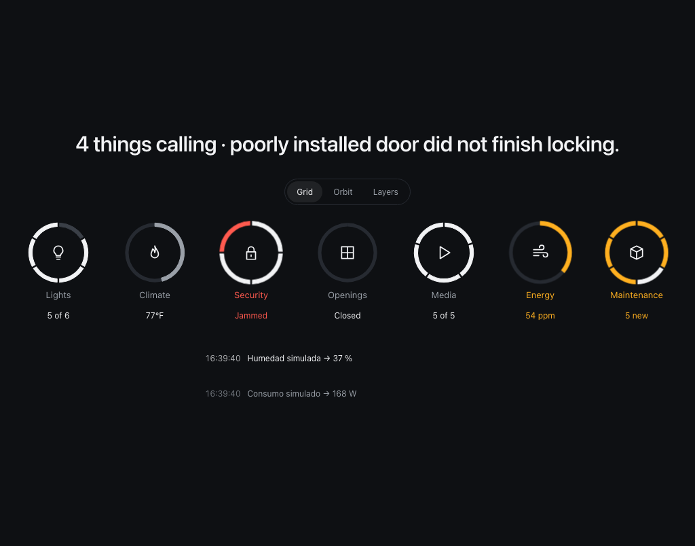
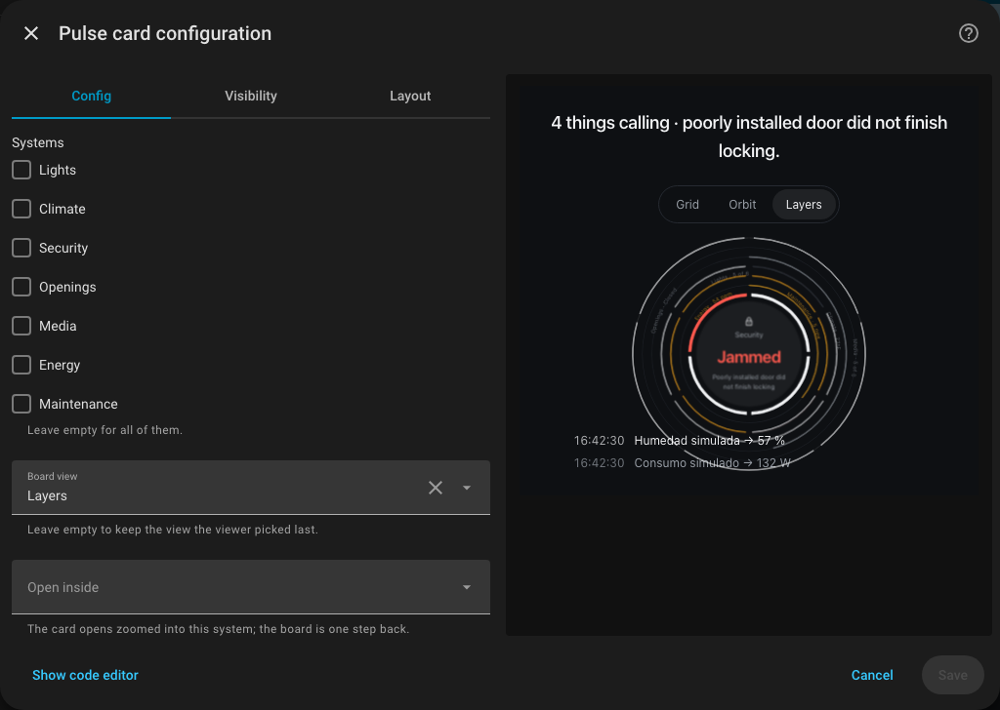
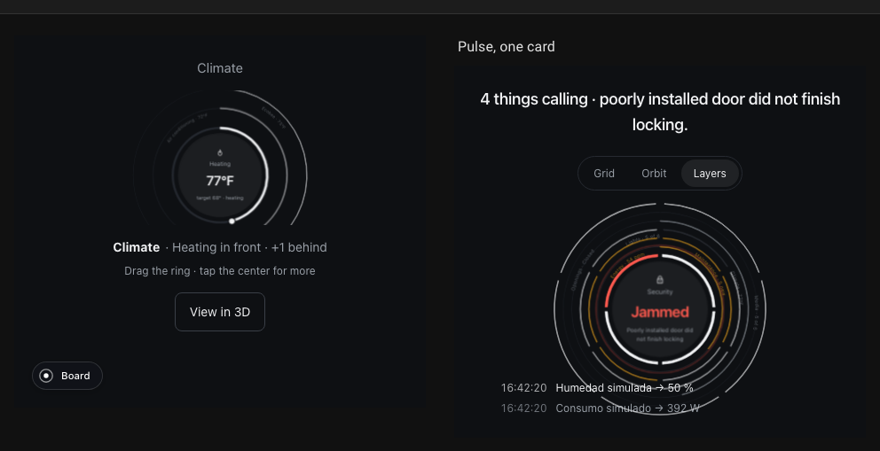
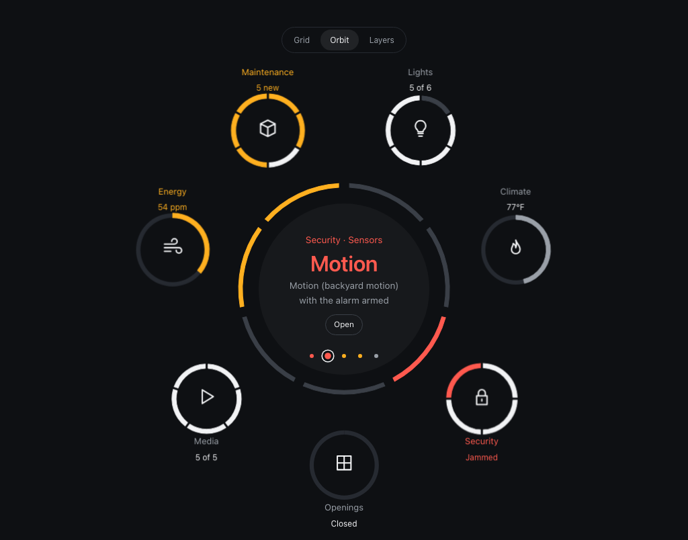
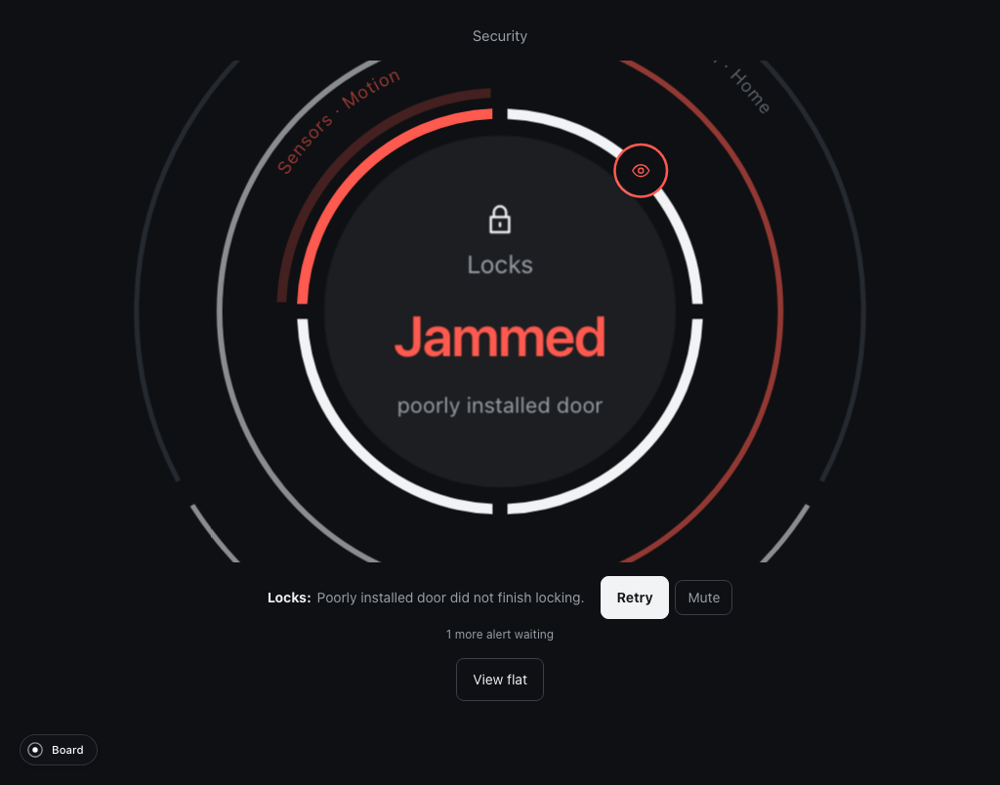

# Pulse for Home Assistant

Pulse shows your home as one radial object per system: lights, climate,
security, openings, media, energy and maintenance. Each system is a ring with
its own controls, and the systems stack in depth by urgency: whatever calls the
most sits in front, the rest waits behind. Nothing is configured by hand. Pulse
reads your entities, decides what each ring shows, and raises an alert when a
rule fires (a jammed lock, a siren, heating with a window open).



This folder is the Home Assistant distribution of Pulse: one JavaScript file,
`pulse-card.js`, that adds three things to your dashboards.

| What | Where it shows up | Use it when |
|---|---|---|
| **Pulse dashboard** | Settings › Dashboards › Add dashboard, under *Community dashboards* | You want Pulse full screen as its own entry in the sidebar |
| **Pulse card** (`custom:pulse-card`) | The *Add card* dialog of any dashboard, with a visual editor | You want Pulse inside a dashboard you already have |
| **Pulse section** | A `strategy:` section of a sections view (YAML) | You want one system, or the board, as a section among others |

## Requirements

- Home Assistant 2026.10 or newer (that is the version it is tested on; earlier
  2025 and 2026 releases will probably work, but are not checked).
- A current browser: Chrome or Edge 111+, Safari 16.4+, Firefox 128+. The rings
  are drawn with recent CSS (trigonometry, `:has()`, registered properties).
  The Companion apps use the system browser, so a current phone is fine.
- No integration, add-on or server component: it is a dashboard resource only.

## Install

1. **Get `pulse-card.js`.** Download it from the latest release of this
   repository, or build it from source:

   ```sh
   npm ci
   npm run build:card        # writes apps/home-assistant/dist-card/pulse-card.js
   ```

2. **Copy it into your Home Assistant.** Put the file in the `www` folder of
   your configuration directory, next to `configuration.yaml`:

   ```text
   config/
     configuration.yaml
     www/
       pulse-card.js
   ```

   If `www` did not exist, create it and **restart Home Assistant once**; it
   only serves that folder after a start.

3. **Register it as a dashboard resource.** In Home Assistant go to
   *Settings › Dashboards*, open the three-dots menu at the top right,
   *Resources*, *Add resource*:

   - URL: `/local/pulse-card.js`
   - Resource type: **JavaScript module**

   The *Resources* entry only appears when *Advanced mode* is on in your user
   profile (your name at the bottom of the sidebar).

4. **Reload the page.** Hard-reload the browser (and, after an update of the
   file, change the URL to `/local/pulse-card.js?v=2` so browsers and the
   Companion apps fetch the new one).

Listing in the Home Assistant Marketplace (HACS) comes once the repository is
public; the install will then be one click, with updates.

## Use

### A Pulse dashboard

*Settings › Dashboards › Add dashboard.* Pick **Pulse** under *Community
dashboards*, give it a title and an icon, and it appears in the sidebar: one
full-screen Pulse, no cards to arrange. To change its options later, open the
dashboard, the pencil, the three dots, *Raw configuration editor*:

```yaml
strategy:
  type: custom:pulse
  # optional, see "Options" below
  mode: orbit
  systems: [lights, climate, security, openings]
```

### The card in a dashboard of yours

Pulse is a card like any other: in a dashboard's edit mode, *Add card*, search
**Pulse**. The visual editor has the three options below, with a live preview.



In a **panel view** the card fills the screen, which is where Pulse is at its
best:

```yaml
views:
  - title: Pulse
    path: pulse
    type: panel
    cards:
      - type: custom:pulse-card
```

In a **sections view** the card takes the full width of its section and at
least six rows (420 px); in a box narrower than 640 px it tightens its board
(smaller headline, fewer log lines). The *Grid* and *Layers* views fit a
section well; *Orbit* wants a full-width section or a panel.



### A section

A sections view can hold a Pulse section generated by the strategy, with the
same options as the card. The left card of the image above is this one:

```yaml
views:
  - title: Home
    type: sections
    sections:
      - strategy:
          type: custom:pulse
          systems: [climate]
          start: climate
      - type: grid
        cards:
          - type: heading
            heading: Pulse, one card
          - type: custom:pulse-card
            mode: layers
```

(Section strategies are not yet listed in the section editor of 2026.10; from
2026.11 they appear there too. Until then, YAML.)

## Options

All optional. They apply to the card, the dashboard strategy and the section
strategy alike.

| Option | Values | Default | What it does |
|---|---|---|---|
| `systems` | list of `lights`, `climate`, `security`, `openings`, `media`, `energy`, `maintenance` | all seven | Which systems the board shows. A system with no matching entities does not show anyway. |
| `mode` | `grid`, `orbit`, `layers` | the view the viewer picked last | The board's view when the card opens. With it set, the switch at the top still works, but the choice is not remembered. |
| `start` | one of the system ids | the board (on a phone, the system that calls the most) | Open the card zoomed into that system. The board stays one step back ("Board" at the bottom left). Must be one of `systems` if both are given. |

A card with a wrong value refuses to render and says why ("Unknown system
"climat". One of: lights, climate, …").

## What you see

**The board.** One ring per system, each with the one reading that matters
(lights on, temperature, alarm state, power), the headline with what calls
("4 things calling · poorly installed door did not finish locking.") and the
latest changes of your entities. Three ways to look at it, switchable at the
top:

| View | What it is |
|---|---|
| **Grid** | A mini ring per system in a row, the log below. Reads fast. |
| **Orbit** | The home's pulse in the center, the systems around it. The center cycles through the alerts and the latest changes; its ring shows which system calls. |
| **Layers** | One object, one system per layer, the one calling the most in front. Tap a band to bring that system forward, the center to enter. |



**A system.** Tap a ring to zoom in. The system's channels are layers of one
object: the one in front has its controls on the ring (segments toggle,
the dial sets a value by dragging), the ones behind are read as arcs with
their label. Alerts come with their action (*Retry*, *Disarm*, *Close
windows*) and *Mute*; a muted alert goes behind and comes back if its text
changes. *View flat* shows the same system as a list; the center opens the
detail with the entities behind each channel.



**What is shown is what was confirmed.** A control beats while the command is
on its way and settles when Home Assistant reports the new state. If the call
fails, the error shows and the value comes back.

## Which entities Pulse uses

Pulse looks at the states Home Assistant already pushes to the dashboard; no
entity list to write. Each channel picks its entities by domain, device class
or capability, and a channel with nothing to show stays out, so every home
builds a different object. A channel that follows one entity takes its name.

| System | Channels and what they look for |
|---|---|
| **Lights** | all `light` entities (segments toggle them) · the first dimmable light (brightness dial) · all `switch` entities as plugs |
| **Climate** | the first two `climate` entities (temperature dials; one may have a range) · a humidity sensor (`device_class: humidity`); past 70% its alert offers the dehumidifier |
| **Security** | the `alarm_control_panel` (arm and disarm) · `siren` entities · `lock` entities · motion, moisture and smoke `binary_sensor`s |
| **Openings** | the first two `cover`s with a position (dials) · the garage door (`device_class: garage`) · `valve` entities |
| **Media** | `media_player` entities (play and pause) · the volume of the first one (dial) |
| **Energy** | a power sensor in W · a carbon monoxide sensor · the `water_heater` (dial) |
| **Maintenance** | `update` entities (install) · `vacuum` entities (start, return to base) |

Alerts are rules over those states; the interesting ones cross systems:

| Alert | When |
|---|---|
| Sirens sounding, lock jammed, alarm triggered, water detected | the entity says so |
| Motion with the alarm armed | a motion sensor is on **and** the alarm is armed |
| Unlocked with the alarm armed | a lock is open **and** the alarm is armed |
| Heating with windows open | a thermostat is heating **and** a window is open |
| Garage open at night | the garage is open **and** the sun is below the horizon |
| Carbon monoxide | 35 ppm (minor), 100 ppm (critical) |
| High humidity | past 70% |
| Updates available | an `update` entity is on |

The exact rules are in `../model.ts`, one function per channel, and that is
the file to change to teach Pulse a new entity or a new rule.

## Troubleshooting

- **"Custom element doesn't exist: pulse-card".** The resource is not loaded:
  check the URL and type under *Resources*, and hard-reload. In the Companion
  app, clear its frontend cache (*Settings › Companion app › Troubleshooting*).
- **The card still looks like the old version after an update.** Change the
  resource URL's `?v=` so the browser fetches the new file.
- **A grey card with an error text.** An option has a wrong value; the message
  names it. In YAML, `systems` is a list and `start` is one id.
- **Rings without arcs, or a flat object.** The browser is too old for the CSS
  the rings need (see Requirements). Kiosk devices with old WebViews show this.
- **Only some systems appear.** That is the home: a system with no matching
  entities is not drawn. Lights with no `light` entity, media with no
  `media_player`, and so on.
- **Nothing reacts to a tap.** The board scrolls inside the card when the box
  is small; make the card taller (*Layout* tab in the card editor) or give it a
  panel view.

## Development

The card is built from the Home Assistant app of this repository
(`apps/home-assistant`): `app.ts` is the object, `card/pulse-card.ts` wraps it
in a custom element with a shadow root and the strategies,
`card/hass-source.ts` feeds it from the `hass` object. Without a Home
Assistant, `card.html` (`npm run dev:ha`, then
<http://127.0.0.1:5174/card.html>) mounts the real card over one of the demo
homes of demo.home-assistant.io; the query string picks the home, the card's
config as JSON, and the box size:

```text
/card.html?home=sections&size=section&config={"systems":["climate"],"start":"climate"}
```

Against a Home Assistant of your own, `scripts/ha-install-card.mjs` registers
the dev server's copy of the build as a resource and creates two dashboards
(the strategy, and a sections view) over the admin WebSocket; the tests in
`tests/ha.spec.ts` cover the card on its bench. The app's own
[README](../README.md) has the rest.

## Licence and credits

Pulse is MIT. It bundles [Orbit](https://github.com/zumerlab/orbit) (the rings
and layers) and [Zumly](https://github.com/zumerlab/zumly) (the zoom), both by
Zumerlab. The demo homes used in development are those of
demo.home-assistant.io, from the Home Assistant frontend (Apache 2.0, see
`../demo/NOTICE.md`).
